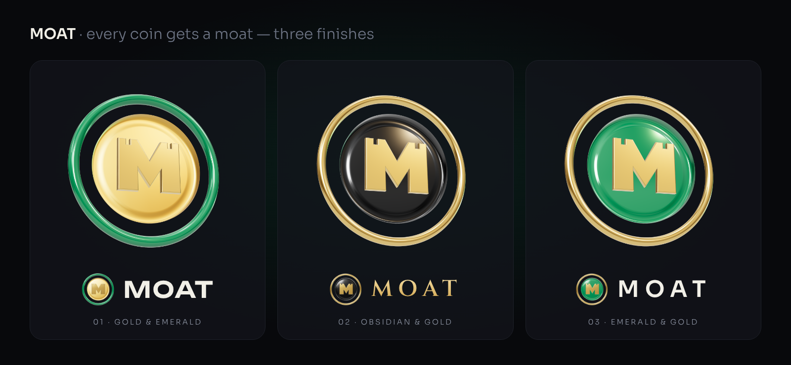

# Moatpad 3D renders

**Every coin gets a moat.** A moat is the defence around a castle; here it is each coin's floor vault. The
symbol is a coin bearing a castle **M** (its two pillars end in battlements) inside a ring: the moat.
Rendered in real 3D (three.js, physically based gold, obsidian and emerald), with three finishes:

| # | Finish | Wordmark |
|---|---|---|
| 01 | Gold coin, emerald moat | Unbounded SemiBold |
| 02 | Obsidian coin, gold castle and moat | Cinzel SemiBold, tracked |
| 03 | Emerald coin, gold moat | Sora SemiBold, tracked |

Each finish has a board (`board-*.png`: hero render, logos on dark and light, app icon, avatar, small sizes)
and an X header (`banner-*.png`). Transparent renders are in `renders/` (`coin-*` tilted, `token-*` near
front-on for icons, `monogram` the castle M on its own).

The Obsidian & Gold finish was chosen; the 2D logo set in `brand/` follows the same geometry.

`src/`: `scene.html` is the three.js scene (`?v=coin-gold-emerald`, `token-obsidian-gold`, `monogram`, …),
`render.mjs` renders it headless (serve the folder with three's package next to it; WebGL via SwiftShader),
`boards.py` + `shots.mjs` compose the boards.
