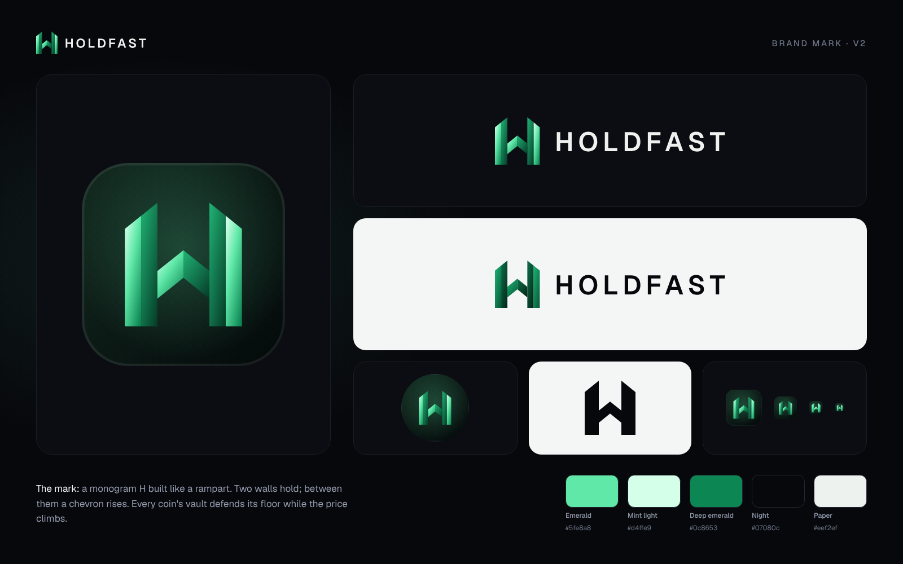

# Holdfast brand

**The mark is a monogram H built like a rampart.** Two walls hold; between them a chevron rises. It is the
product in one shape: every coin's vault defends its floor while the price climbs. The pillars' tops rise
toward the centre and every diagonal shares one slope. The outer faces catch the light and the inner faces
sit in shade, so the walls read as folded metal.

The wordmark is **HOLDFAST** in Geist SemiBold, set in capitals with wide tracking (0.16 em, F–A kerned),
outlined to paths so no font is needed.



## Files

| File | Use |
|---|---|
| `holdfast-logo.svg` | Primary horizontal logo, for dark backgrounds |
| `holdfast-logo-on-light.svg` | Horizontal logo for light backgrounds (deep emerald mark, night wordmark) |
| `holdfast-logo-white.svg` | One-colour white, for photos and busy backgrounds |
| `holdfast-logo-stacked.svg` | Mark above wordmark: splash screens, square layouts |
| `holdfast-mark.svg` / `holdfast-mark-on-light.svg` | The mark alone (dark / light backgrounds) |
| `holdfast-mark-white.svg` / `holdfast-mark-black.svg` | One-colour silhouettes |
| `holdfast-icon.svg` | App icon: the mark on the night tile with an emerald glow |
| `holdfast-favicon.svg` | Small sizes (≤ 32 px): flat mark, larger in the tile. Used as `apps/web/src/app/icon.svg` |
| `holdfast-avatar.svg` | Full-bleed square for X, Telegram and Discord profile pictures (survives a circle crop) |
| `holdfast-wordmark.svg` / `holdfast-wordmark-on-light.svg` | Wordmark alone |
| `png/` | Exports: app icon 1024/512, apple-touch-icon 180, avatar 1000/400, mark 1024, logos on dark / light / transparent, stacked logo, X header 1500×500, brand board |

## Colours

| Name | Hex | Role |
|---|---|---|
| Emerald | `#5fe8a8` | the brand colour |
| Mint light | `#d4ffe9` | highlight end of the lit gradient |
| Deep emerald | `#0c8653` | shadow end of the lit gradient; the mark on light backgrounds |
| Night | `#07080c` | backgrounds, dark wordmark |
| Paper | `#eef2ef` | light wordmark |

## Rules

- Clear space: at least half the mark's width on every side of the logo.
- Minimum sizes: horizontal logo 20 px tall; mark 16 px (use `holdfast-favicon.svg` below 32 px).
- Use the lit/shade colouring or a one-colour version. Don't recolour single faces, add outlines or
  shadows, rotate, or stretch.
- Don't set the wordmark in another font or in lower case. The product is "Holdfast" in running text,
  "HOLDFAST" in the logo, and the token is **$HOLD**.

## Regenerating

```bash
pip install fonttools && python3 brand/generate.py      # SVGs
cd apps/web && cp ../../brand/export.mjs .brand-export.mjs && node .brand-export.mjs; rm .brand-export.mjs   # PNGs
```

The web app draws the same mark in `apps/web/src/components/layout/Logo.tsx`; keep the coordinates in sync.
