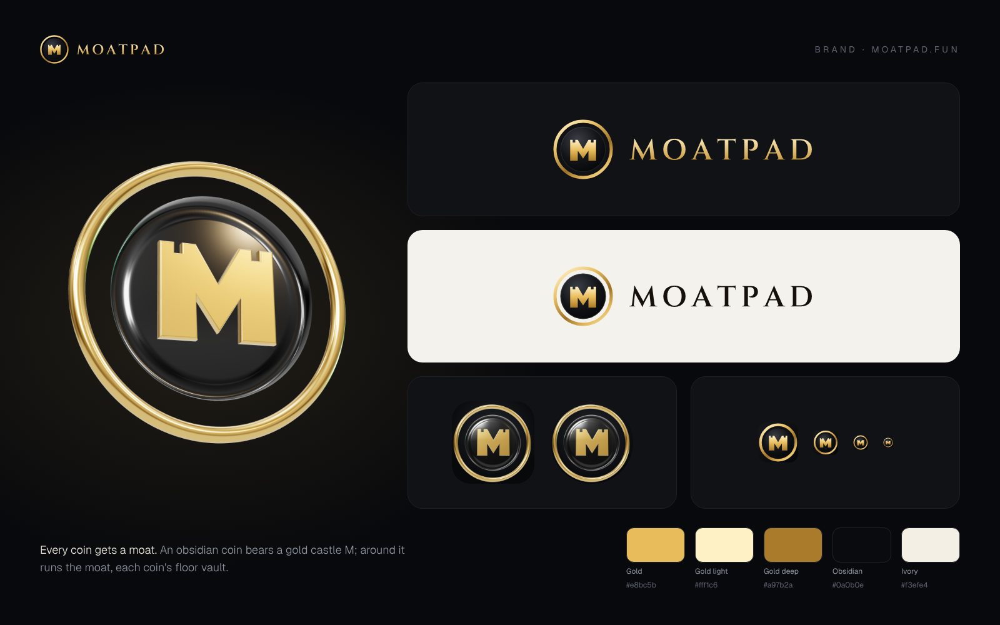

# Moatpad brand

**Every coin gets a moat.** A moat is the defence around a castle; on Moatpad it is each coin's floor vault,
which buys back at the floor and pays holders. The mark is an **obsidian coin bearing a gold castle M** (its two
pillars end in battlements) inside a **gold ring: the moat**. The wordmark is **MOATPAD** in Cinzel SemiBold,
tracked capitals, outlined to paths. Domain: **moatpad.fun**. Token: **$MOAT**.



## Files

| File | Use |
|---|---|
| `moatpad-logo.svg` | Primary horizontal logo, gold wordmark, for dark backgrounds (`apps/web/public/brand/`) |
| `moatpad-logo-on-light.svg` | Horizontal logo for light backgrounds (ink wordmark) |
| `moatpad-logo-stacked.svg` | Coin above the wordmark: splash screens, square layouts |
| `moatpad-mark.svg` | The coin alone, with rim light and embossed castle |
| `moatpad-mark-small.svg` / `moatpad-favicon.svg` | Simplified coin for ≤ 32 px; the favicon sits on an obsidian tile (`apps/web/src/app/icon.svg`) |
| `moatpad-wordmark.svg` / `moatpad-wordmark-on-light.svg` | Wordmark alone |
| `3d/renders/` | Real 3D renders (three.js, physically based materials): `coin-*` tilted, `token-*` near front-on, `monogram` the castle M alone, in all three finishes |
| `png/moatpad-x-header-*` | **Premium X header**: 3D coin over a glossy floor with gold dust; `full` (with the fee split) and `minimal`, at 1500×500 and 3000×1000 |
| `png/` (others) | App icon 1024/512, apple-touch-icon 180, avatar 1000/400 (3D), coin 3D, mark 1024, logos on dark / light / transparent, stacked logo, simple X banner, brand board |

Use the **3D coin** where the logo is large and alone (app icon, avatar, X header, hero) and the **2D logo** in
interfaces and small sizes.

## Colours

| Name | Hex | Role |
|---|---|---|
| Gold | `#e8bc5b` | castle, moat, wordmark |
| Gold light | `#fff1c6` | highlights |
| Gold deep | `#a97b2a` | shadows of the gold |
| Obsidian | `#0a0b0e` | the coin, backgrounds |
| Ivory | `#f3efe4` | light backgrounds |

## Rules

- Clear space: half the coin's width around the logo. Minimum size: logo 22 px tall, coin 16 px (use the favicon).
- Keep the coin obsidian and the castle and moat gold. Don't recolour, outline, stretch or rotate the 2D logo.
- The wordmark is always MOATPAD in Cinzel capitals. In running text the name is "Moatpad".

## Regenerating

```bash
pip install fonttools && python3 brand/generate.py      # SVGs (+ copies into apps/web)
cd apps/web && cp ../../brand/export.mjs .brand-export.mjs && node .brand-export.mjs; rm .brand-export.mjs   # PNGs
```

3D renders: `brand/3d/src` (see `brand/3d/README.md`). The X header: `hero.html` renders the coin,
`python3 brand/3d/src/header.py` composes it (text stays clear of the profile picture at the bottom left). Cinzel is SIL Open Font License (`fonts/OFL-Cinzel.txt`).
