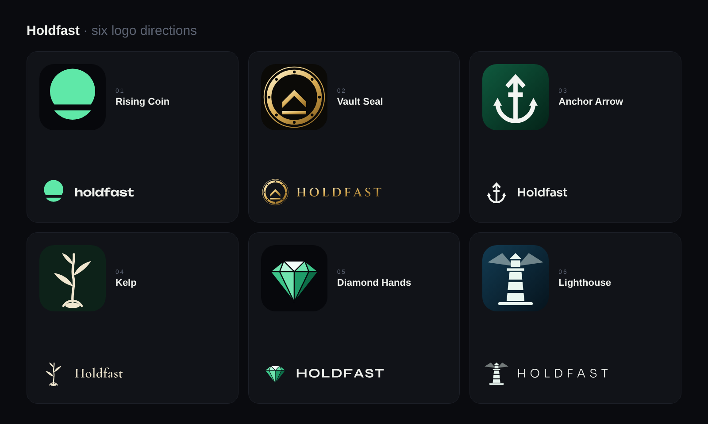

# Logo directions

Six alternatives to the current mark (`brand/`), for the owner to choose from. Each board shows the app icon,
the horizontal logo on dark and light, the avatar, and the mark from 72 px down to 16 px.

| # | Direction | Idea | Colour | Wordmark |
|---|---|---|---|---|
| 01 | Rising Coin | A coin split at its floor: the bottom holds, the top lifts off | flat emerald on night | Unbounded SemiBold, lower case |
| 02 | Vault Seal | A vault door with eight bolts; a chevron rises over the floor | gold on black | Cinzel SemiBold, tracked capitals |
| 03 | Anchor Arrow | An anchor whose ring is an arrow pointing up | white on bank green | Sora SemiBold |
| 04 | Kelp | A kelp frond rising from the holdfast that grips its stone | cream on deep green | Cormorant Garamond SemiBold |
| 05 | Diamond Hands | A brilliant-cut diamond: the holders Holdfast pays | faceted emerald | Syne Bold, capitals |
| 06 | Lighthouse | A lighthouse on its rock: it holds through storms and shows the way | white on deep sea blue | Sora, wide-tracked capitals |

Once a direction is chosen it becomes the brand set in `brand/` (SVG masters, PNG exports, app icon,
favicon, avatar, X header) and replaces the logo in the web app.

`src/` holds the generators: `marks.py` draws the six marks on a 100 × 100 grid, `boards.py` outlines the
wordmarks (fonts from the `@fontsource` packages, all SIL Open Font License; point `FONTSOURCE_DIR` at the
unpacked packages) and writes the boards as HTML, and `render.mjs` screenshots them with Playwright.
